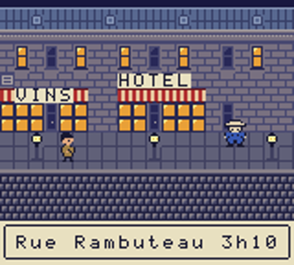

# PARIS DISPARU — La vie qui n'existe plus

An original exploration game for the **Game Boy Color**, set in Paris around
1967. You wander the streets around the old Les Halles market before dawn,
meet the people who work there, and take part in everyday life that no longer
exists. No combat, no quest markers, no collectibles: the historical
experiences are the reward.

 


Screenshots are captured automatically by `tests/play_test.py` in the PyBoy
emulator.

## Status

**Milestone 1 (first playable) — implemented.** Everything below is in the
ROM and checked by the automated emulator test, unless marked otherwise.

| Feature | State |
|---|---|
| CGB-only ROM with valid header (MBC5, CGB flag 0xC0) | done, checked by `tests/check_rom.py` |
| Title screen | done |
| Rue Rambuteau street scene, original pixel art | done (1 screen) |
| Player: 4-direction movement, walk animation | done |
| Tile collision (facades, lamp posts, screen edges) and NPC collision | done, tested |
| NPC (Fernand, market porter) with French dialogue, first/repeat lines | done, tested |
| Examine objects with A (doors, lamps, shop windows, street plaque) | done |
| Dialogue box: typewriter text, A = next page, B = close | done, tested |
| START pause box | done, tested |
| Distant market noise that gets louder towards the market | done, **not verified by ear** (tests run with sound off) |
| Message on a monochrome Game Boy | done, **not tested** |
| Market entrance, market interior, café, 3 other NPCs, 3 experiences | planned (see [ROADMAP](docs/ROADMAP.md)) |
| Music | planned |
| Real hardware / ModRetro Chromatic | **not tested yet** |

## Controls

| Button | Action |
|---|---|
| D-pad | Walk |
| A | Talk, examine, next page |
| B | Close dialogue |
| START | Start game / pause |

## Building

Requirements:

- [GBDK-2020](https://github.com/gbdk-2020/gbdk-2020/releases) 4.3.0 (tested; other 4.x versions likely work)
- GNU make
- Python 3 (only to regenerate assets and run the checks)

```sh
# Linux example
curl -sSLO https://github.com/gbdk-2020/gbdk-2020/releases/download/4.3.0/gbdk-linux64.tar.gz
tar xzf gbdk-linux64.tar.gz -C ~
make GBDK_HOME=~/gbdk
```

Output: `build/paris-disparu.gbc` (32 KiB). The generated asset files
`src/assets.c` and `include/assets.h` are committed, so Python is not needed
for a plain build.

Other targets:

```sh
make assets      # regenerate assets from tools/*.py and assets/ (python3)
make check       # asset freshness + ROM header validation
python3 tests/play_test.py build/paris-disparu.gbc [screenshot_dir]   # needs: pip install pyboy
```

## Running

Open `build/paris-disparu.gbc` in a Game Boy Color emulator such as
[SameBoy](https://sameboy.github.io/), [BGB](https://bgb.bircd.org/) or
[mGBA](https://mgba.io/), with the emulated model set to Game Boy Color.
The automated test uses PyBoy; the game has not yet been checked in SameBoy,
BGB or on hardware.

## Repository layout

```
src/            game code (C)            include/   headers
assets/maps/    room maps as text        assets/dialogue/fr.txt   French dialogue
assets/text/    UI strings               tools/     font, art and asset generator
tests/          ROM header check, emulator gameplay test
docs/           design, architecture, research, roadmap
```

## Historical research

The game separates verified facts, plausible reconstructions and fiction.
All characters are fictional. Claims and their sources, with confidence
levels, are tracked in [docs/HISTORICAL_RESEARCH.md](docs/HISTORICAL_RESEARCH.md).

## Licence

No licence has been chosen; all rights reserved. See
[LICENSE-PENDING.md](LICENSE-PENDING.md). Game Boy and Game Boy Color are
trademarks of Nintendo; this project is not affiliated with or endorsed by
Nintendo.
