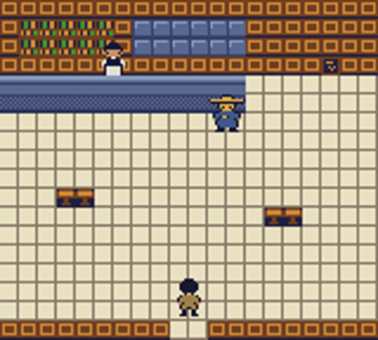
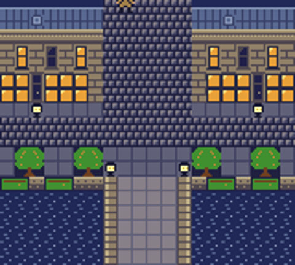
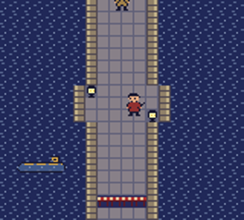
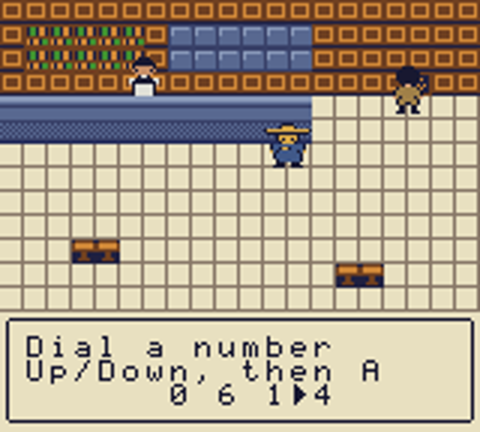
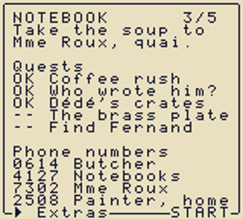
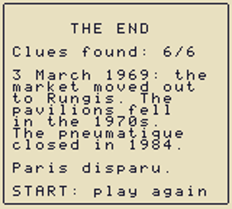

# PARIS DISPARU — La vie qui n'existe plus

An original exploration game for the **Game Boy Color**, set in Paris around
1967. The game is in **English**, **French** or **Korean** (chosen after the title); signs and place names stay in French. You wander the streets around the old Les Halles market before dawn,
meet the people who work there, and solve a small mystery that could only
happen there and then: **Fernand, a fort des Halles for thirty years, has
not come to work tonight.** Everyone knows the market will leave for Rungis.
Clues come from a petit bleu (pneumatic post), jeton telephone calls, his
coltin and his fort's plate, and go into a notebook (START). No combat, no
crime.

 
 
 
  
 

Screenshots are captured automatically by `tests/play_test.py` in the PyBoy
emulator.

## Status

**Episode 1 vertical slice (Les Halles, 1967) — first complete version.**
Everything below is in the ROM and exercised by the automated play-through
(`tests/play_test.py`), unless marked otherwise.

| Feature | State |
|---|---|
| CGB-only ROM with valid header (MBC5, CGB flag 0xC0) | done, checked by `tests/check_rom.py` |
| The Fernand mystery: 6 clues (the man with the notebook, Simone and the coltin, call ARC 4127, the petit bleu, call MED 7302 and the plate, Germaine after the crates), Fernand found on the bridge, two endings (Stay / Go with), an end screen with clues found and real dates (Rungis 1969, pneumatique closed 1984) | done, tested (both endings) |
| Notebook on START: current goal, clues found (n/6), phone numbers learned; a "New clue!" note when one is found | done, tested |
| Title key art (night view: church with lantern tower behind a lit iron-and-glass pavilion, gas lamps, a fort carrying a crate), fade-in; speaker portraits on the dialogue box; flickering lamp light | done, tested in PyBoy; composition is original and not a measured drawing of Saint-Eustache |
| One cameo: an unnamed photographer at dawn, inspired by a real photographer's documented weekly visits to Les Halles (see docs/HISTORICAL_RESEARCH.md, Cameos; needs legal review before release) | done, tested |
| Location caption | done, tested |
| 7 connected areas on the real layout: rue Rambuteau, rue Baltard, pavilion interior, café, métro ticket hall, quai of the Seine, Pont Neuf | done, tested (screen edges + doors) |
| Seine: animated water, a barge that passes under the bridge, gas lamps, bouquinistes' boxes, plane trees | done, tested (barge movement checked in RAM) |
| Player: 4-direction movement, walk animation, tile + NPC collision | done, tested |
| 6 NPCs whose dialogue changes with what you have done (incl. a painter on the bridge) | done, tested |
| Experience A: carry Fernand's three crates to the right stalls (read the signs; wrong stall gets a reaction; half speed while carrying) | done, tested |
| Experience B: café scene (Simone keeps Fernand's coltin and his petit bleu; a porter asleep on his feet) | done, tested |
| Experience C: the café wall telephone. Get a token (jeton) from Simone, then dial a number with the D-pad. Four numbers are hidden in the world (the café wall, the man with the notebook, a bouquiniste's box, the painter); each call is a different scene | done, tested — historical details **to research** |
| Two-option choices in dialogue | done, tested |
| Quest chain (5 quests) with "QUEST COMPLETE!" and fanfare; new mini-games: coffee rush (serve), cup game (jeton), catch the cabbages; Mme Roux trade (gratinée for the plate) | done, tested |
| Title credit "© Jiwon" | done |
| Opening: skippable 3-page intro (setting, goal, controls), one-line goal on screen, a cat to chase to the café | done, tested |
| Fernand and the notebook always say what is still missing | done, tested |
| Second cameo: an unnamed singer by the river (inspired by Serge Gainsbourg, logged with sources and a legal-review flag) who then gives hints | done, tested |
| Side goals: 3 extras on notebook page 2 with payoffs, a bonus ending scene, and an Episode 2 hook screen | done, tested |
| Era culture in the scenery (onion soup, Salut les copains, yé-yé radio, Tati's Playtime poster, Ionesco playbill, Zola, a Baudelaire verse), each sourced with rights status | done, tested (soup) |
| Vanished Paris: Les Halles métro ticket hall, a ticket puncher (poinçonneur, gone since 1973) and a punch mini-game | done, tested |
| Player sprite visible after every room change (`tests/visibility_test.py`) | done, tested |
| NPCs call out short lines by themselves when you come near, hinting at what to do ("A: talk" shown). The line stays until you walk away or press A/B; the opening caption stays 15 s or until A/B | done, tested |
| Quiet scene-based sound: a soft knock every 1-3 s in the market, water on the quai, a faint cup tick in the café; one soft chime when a dialogue opens | done. Captured from the emulator (PyBoy) and checked for pitch, level and rate, **not yet heard by a person** |
| Original music: 7 loops composed for the game (title, street, market, café, river, métro, mini-games), musette waltzes and polkas, melody on the wave channel over a plucked accompaniment; effects borrow channel 1 | done. Pitches checked from an emulator (PyBoy) recording, **not yet heard by a person** |
| "Vanished Paris" album: notebook page 3 collects five period objects with a sourced one-line fact each | done, tested (English; the Korean page is not screen-checked) |
| Curiosities: three vanished objects found as "???" (a green first-class métro ticket, a VéloSolex roller, a Tutankhamun exhibition stub), each identified by the one person who knows; notebook page 4 "Mysteries" | done; ticket tested in a full playthrough, roller and stub identification tested from saves (`tests/save_test.py`); the roller and stub pick-ups are not covered by a test |
| 1967 phone numbers: exchange + 4 digits ("ARC 4127"), the dial sets the exchange and the digits; ODÉ 8400 is the speaking clock | done, tested (English; Korean dial and rules card screenshot-checked) |
| Item pictures: the object itself (coltin, petit bleu, plate, gratinée, jeton, tickets, roller, stub) above the note when you get it, and a cup in the coffee game | done, tested (tiles checked in VRAM; English and Korean screenshot-checked) |
| Night clock 03:00 → 07:00 (one hour per quest, notebook) with the sky turning slightly bluer | done, tested (clock); palette change checked by screenshot |
| End-screen rank (Tourist → Paris legend) | done, tested (one rank seen in the playthrough) |
| French option: every dialogue and menu in French (same 8x8 font and layout as English; no-break spaces before ! ? : ;), chosen on the language menu (English / Français / 한국어) | done, tested (`tests/fr_test.py`: menu, intro, caption, notebook, a bark, a dialogue and its choice; notebook pages, dial, end screen and teaser screenshot-checked). **Written by Claude: a review by a native French speaker is advised** |
| Korean option: dialogue, menus, notebook and captions in Galmuri11 (12-px glyphs, 16-px lines) | done; every Korean screen type screenshot-checked in PyBoy (intro, notebook 4 pages, captions, rules card, cup game, dial, choice, ending, teaser, continue menu) |
| Music on/off with SELECT (sound effects stay), remembered in the save; the web page also has a "Sound" button that mutes everything | done, tested (`tests/save_test.py`) |
| Save / continue: automatic save to battery RAM (room changes, closed dialogues), Continue / New game menu, cleared at the ending | done, tested (`tests/save_test.py`) |
| Fuller rooms: baskets, chairs, a bench, posters and three more people (a fort, a cook, a night worker) | done, tested |
| Juice: room fades, a star over the player on every find, a shake when the pickpocket bumps you | done, tested (the star is checked in OAM) |
| Message on a monochrome Game Boy | written, **not tested** |
| SameBoy / BGB / real hardware / ModRetro Chromatic | **not tested yet** |

A first-time play-through to the ending has not been timed with a player
yet (target 10-15 minutes); see [ROADMAP](docs/ROADMAP.md). The mystery and
all characters are fiction (see docs/HISTORICAL_RESEARCH.md).

## Controls

| Button | Action |
|---|---|
| D-pad | Walk |
| A | Talk, examine, next page |
| B | Close dialogue |
| START | Start game / pause |

## Building

Requirements:

- [GBDK-2020](https://github.com/gbdk-2020/gbdk-2020/releases) 4.3.0 (tested; other 4.x versions likely work)
- GNU make
- Python 3 (only to regenerate assets and run the checks)

```sh
# Linux example
curl -sSLO https://github.com/gbdk-2020/gbdk-2020/releases/download/4.3.0/gbdk-linux64.tar.gz
tar xzf gbdk-linux64.tar.gz -C ~
make GBDK_HOME=~/gbdk
```

Output: `build/paris-disparu.gbc` (64 KiB, MBC5: code in bank 0, graphics/maps in bank 1, dialogue in bank 2). The generated asset files
`src/assets.c` and `include/assets.h` are committed, so Python is not needed
for a plain build.

Other targets:

```sh
make assets      # regenerate assets from tools/*.py and assets/ (python3)
make check       # asset freshness + ROM header validation
python3 tests/play_test.py build/paris-disparu.gbc [screenshot_dir]   # needs: pip install pyboy
python3 tests/visibility_test.py build/paris-disparu.gbc
```

## Running

Open `build/paris-disparu.gbc` in a Game Boy Color emulator such as
[SameBoy](https://sameboy.github.io/), [BGB](https://bgb.bircd.org/) or
[mGBA](https://mgba.io/), with the emulated model set to Game Boy Color.
The automated test uses PyBoy; the game has not yet been checked in SameBoy,
BGB or on hardware.

## Repository layout

```
src/            game code (C)            include/   headers
assets/maps/    room maps as text        assets/dialogue/en.txt   dialogue (English)
assets/text/    UI strings               tools/     font, art and asset generator
tests/          ROM header check, emulator gameplay test
docs/           design, architecture, research, roadmap
```

## Historical research

The game separates verified facts, plausible reconstructions and fiction.
All characters are fictional. Claims and their sources, with confidence
levels, are tracked in [docs/HISTORICAL_RESEARCH.md](docs/HISTORICAL_RESEARCH.md).

## Licence

No licence has been chosen; all rights reserved. See
[LICENSE-PENDING.md](LICENSE-PENDING.md). Game Boy and Game Boy Color are
trademarks of Nintendo; this project is not affiliated with or endorsed by
Nintendo.
